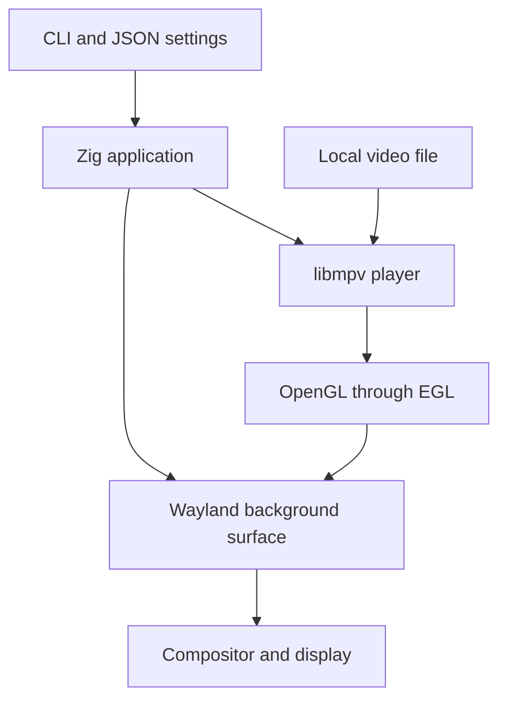
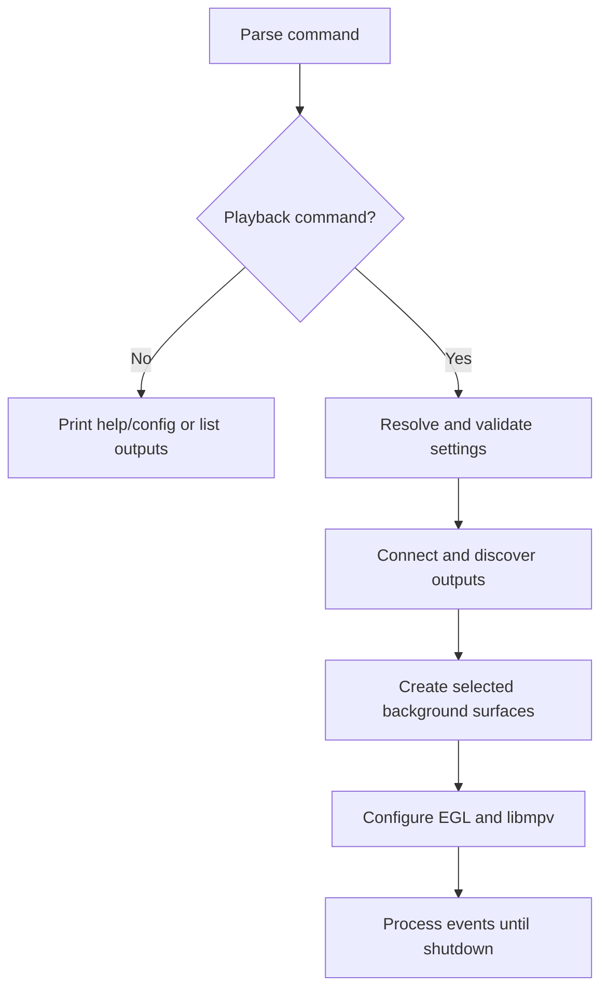
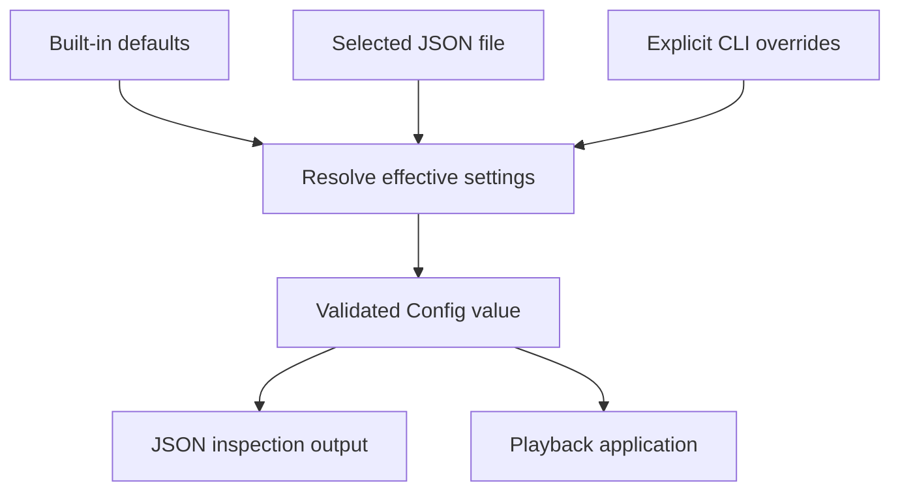
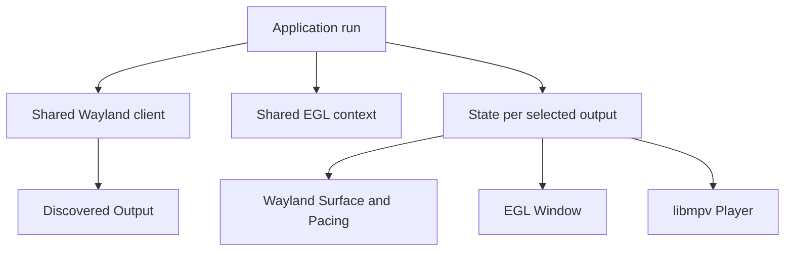
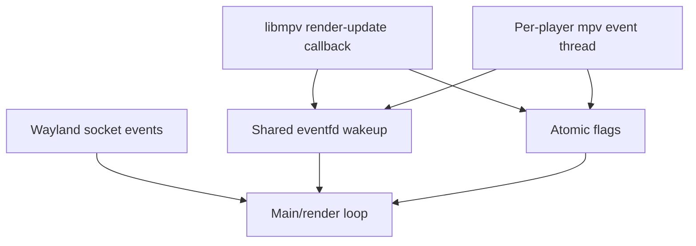
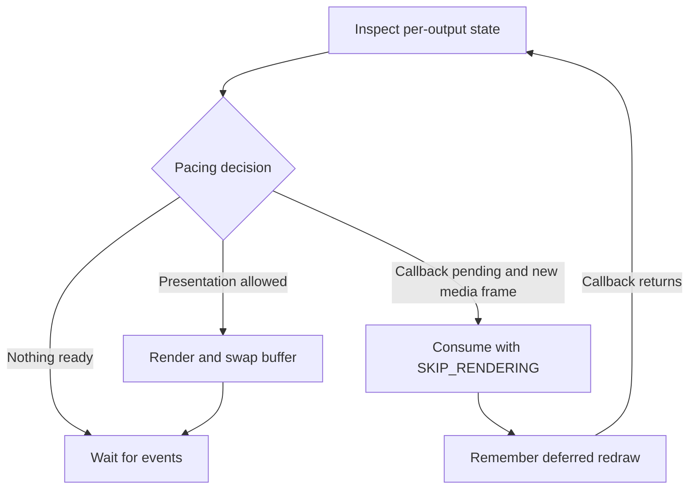
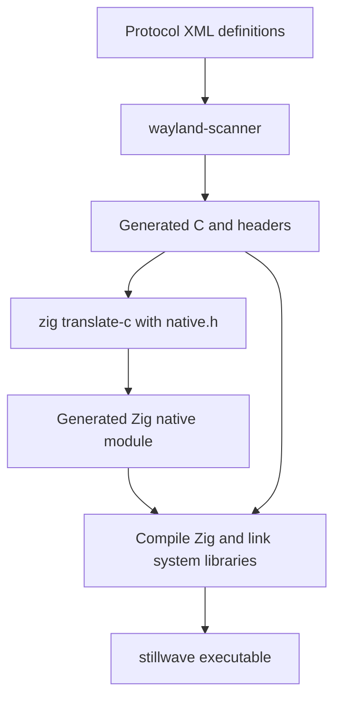
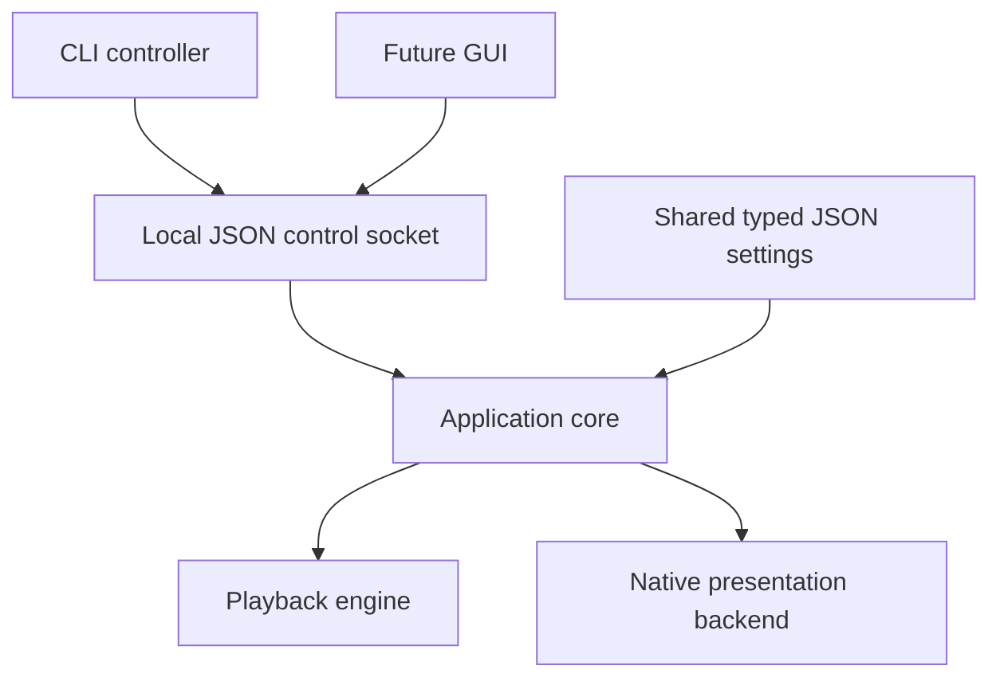

# Stillwave: architecture and roadmap

This document explains **how the current program fits together**, why it is
structured this way, and where it can go next. It is also a reading guide for
learning Zig through a working systems program.

The current product is a **CLI video-wallpaper proof of concept**, not a port of
Wallpaper Engine's proprietary code or a complete implementation of its formats.
For installation, commands, and configuration examples, see [README.md](README.md).

> **Scope:** this is a program architecture guide, not yet a Wayland/compositor
> tutorial. The short definitions below are only enough to follow the code.
> Sections marked **future** describe proposals, not implemented features.

## 1. The mental model

The application has two main jobs:

1. Ask the desktop for a place to display a wallpaper behind application windows.
2. Keep that place supplied with frames decoded from a video file.

Zig coordinates the work; existing native libraries do video decoding and most
GPU rendering. The compositor—not this application—combines the wallpaper with
other desktop content and decides what is actually visible.

Arrows here show the main control/content relationships, not a literal copy of
pixel data at every step. A GPU-backed path may avoid some copies; zero-copy is
not guaranteed.

### Just enough vocabulary

| Term | Meaning in this program |
| --- | --- |
| **Compositor** | Desktop software that combines application surfaces and decides their placement, stacking, and visibility. Hyprland is one example, not a dependency. |
| **Wayland** | Protocols through which our application communicates with the compositor. It is not a particular desktop or shell. |
| **Output** | A display destination advertised by the compositor; do not assume it is a particular physical connector or monitor layout. |
| **Surface** | A destination for content submitted to the compositor. A surface is not automatically a normal application window. |
| **Layer-shell** | An optional protocol that lets us request a background-layer surface. Not every Wayland compositor supports it. |
| **OpenGL** | The graphics API used by libmpv to render video into our render target. |
| **EGL** | The connection between an OpenGL context and the native surface/window we present through. |
| **libmpv** | The embeddable player library; handles media loading, decoding, playback timing, and video rendering. We do not launch the `mpv` executable. |
| **Callback** | A function another library invokes later to notify us about an event. |

**Three separate questions matter:** did the video decode, did we submit a
buffer, and did the compositor make that surface visible? Success at one does
not prove success at the others. This distinction explained our first invisible-
wallpaper debugging session.

## 2. What is implemented

- Foreground CLI with local video playback, looping, muting, fill/fit scaling,
  optional hardware decoding, and a start-paused setting.
- Versioned JSON settings, XDG configuration discovery, and explicit CLI overrides.
- Playback on all connected outputs by default, or a selected subset by name.
- A background surface and independent player per selected output.
- Compositor-provided surface sizing, integer/fractional scaling, and output
  removal/reconnection handling.
- Event-driven rendering, hidden-frame consumption, and signal-driven shutdown.

No GUI, runtime control socket, per-output video configuration, X11 backend, or
Wallpaper Engine scene/web renderer exists yet. Multi-output/hotplug code is
implemented, but broad live coverage of mixed-display setups remains outstanding.

### Important boundaries

- Normal application windows belong above the wallpaper. We do not force it
  above them to work around visibility issues.
- No keyboard focus is requested; an empty input region prevents the surface
  from intercepting pointer input.
- The program requires advertised Wayland capabilities, not Hyprland, DMS, or
  shell-specific commands. `hyprctl` was used during development inspection only.
- Another background provider can cover us: ordering within the background layer
  is not guaranteed. The app does not stop providers or edit desktop settings.

## 3. Source map

Links point to hand-written source, not generated bindings.

| File | Responsibility | Useful entry points |
| --- | --- | --- |
| [src/main.zig](src/main.zig) | Entry point, command routing, errors and exit codes | `main`, `execute` |
| [src/cli.zig](src/cli.zig) | Parse arguments into a command and explicit overrides | `Options`, `parse` |
| [src/config.zig](src/config.zig) | Typed settings, JSON parsing, merging, validation | `Config`, `Overrides`, `load`, `validateRunnable` |
| [src/xdg.zig](src/xdg.zig) | Configuration location and relative-path rules | `configPath`, `discover`, `resolve` |
| [src/app.zig](src/app.zig) | Playback lifecycle, per-output ownership, event loop | `run`, `State`, `listOutputs` |
| [src/platform/wayland.zig](src/platform/wayland.zig) | Capability/output discovery and wallpaper surfaces | `Client`, `Output`, `Surface` |
| [src/render/egl.zig](src/render/egl.zig) | OpenGL context and native presentation windows | `Context`, `Window` |
| [src/render/pacing.zig](src/render/pacing.zig) | Pure draw/skip/wait decisions | `Pacing` |
| [src/player.zig](src/player.zig) | libmpv setup, events, rendering, notifications | `Player`, `pollUpdate`, `draw`, `skip`, `events` |
| [src/support.zig](src/support.zig) | Diagnostics and small libc-backed I/O helpers | `Diagnostic`, `readFile`, `json` |
| [src/native.h](src/native.h), [src/c.zig](src/c.zig) | Native API declaration boundary | Generated `native` module import |
| [build.zig](build.zig) | Build graph, generated code, native library linkage, tests | `build` |
| [scripts/install-system.sh](scripts/install-system.sh) | Resolve current HOME and copy the binary on explicit request | `zig build install-system` |

`app.zig` is currently the concrete Wayland orchestrator, **not** an established
cross-platform backend interface. `listOutputs` also formats CLI output, and
player diagnostics currently go straight to stderr. These are practical POC
choices; a future GUI will need a cleaner query/event boundary.

## 4. From a command to a running wallpaper

For `run`:

1. `main.execute` parses arguments and loads effective settings.
2. `config.validateRunnable` checks that media is present and is a readable,
   regular local file. libmpv later determines whether it can decode it.
3. `Client.init` connects to Wayland, discovers interfaces/outputs, and collects
   initial output metadata. Required capabilities and explicit output names are
   checked before starting playback resources.
4. The application creates a shared EGL context and a `State` for each selected
   output. Initially a state has a Wayland surface but no EGL window/player.
5. The compositor sends a surface configuration. The client acknowledges it and
   records its dimensions; buffers are not attached before this handshake.
6. On a later loop iteration, the configured state gets an EGL window and player.
   libmpv's render context is created before asynchronously loading the file.
7. The first libmpv FRAME update allows initial presentation. Configuration
   dirtiness alone is not treated as a decoded video frame.

Some commands avoid most of this:

| Command | Load user config? | Connect to Wayland? |
| --- | --- | --- |
| `--help`, `--version`, `config defaults` | No | No |
| `config show`, `config validate` | Yes, unless disabled | No |
| `list-outputs` | No | Yes; no playback surfaces |
| `run` | Yes, unless disabled | Yes, after media-path validation |

`config validate` checks settings, not file existence or codec support. A valid
JSON template may still have `media: null` and therefore not be runnable.

## 5. Configuration is data, not live resources

Precedence is **defaults < JSON < CLI**. `Config` is the effective settings
structure. `Overrides` uses optional fields to distinguish “the user did not
specify this” from values such as `false` or an empty output selection.
For example, `--no-loop` must override `"loop": true`; `--all-outputs` must clear
a file's selected names rather than leave them unchanged.

Configuration discovery uses an absolute `$XDG_CONFIG_HOME`, otherwise
`$HOME/.config`, under `stillwave/config.json`. An absent implicit file is
fine; a missing explicit `--config` file is an error. Reads do not create or
rewrite configuration files.

Paths retain their origin during resolution:

- JSON media path: relative to the selected configuration file's directory.
- CLI media path: relative to the invocation directory.
- Effective JSON output: absolute media path.

There is no shell expansion or shell-based playback. The JSON parser rejects
unknown/duplicate fields and unsupported versions. The external
[config.schema.json](config.schema.json) describes the format, but the program
validates with Zig code rather than a general JSON Schema engine. Tests check
that defaults and the [example](examples/config.json) agree with the schema.

Settings are serializable; GPU handles, threads, callbacks, decoder state, and
current playback position are not part of this configuration format. Keeping
that distinction makes a future GUI possible without putting live native
objects into JSON.

## 6. Multi-output resources and ownership

This is a lifetime overview, not a strict ownership tree: a `State` holds a
reference to its discovered `Output`; the `Client` owns that output object.
Each EGL window uses the shared EGL context. Each `Player` has its **own** mpv
core and mpv render context, using the application-owned OpenGL context.

Consequences:

- Three selected outputs mean three independent players/decoders, not one video
  stretched across a desktop-sized rectangle.
- Each output has separate configure dimensions, buffer size, frame callback,
  and pacing state. One output's pending callback does not block another.
- There is no frame-exact synchronization. Newly connected/reconnected outputs
  start the video from the beginning.
- Resource use grows with the number of outputs. Sharing decoded video is a
  possible optimization, not today's design.
- Audio is disabled by default. When enabled, the application selects one active
  player to be audible so that every monitor does not play a duplicate soundtrack.

The compositor's logical surface dimensions and the preferred scale determine
buffer pixels. The code does not derive placement from a monitor's physical
size, coordinates, or filename-like output name. Preferred fractional scale is
expressed in units of 1/120; integer scaling is the fallback. Output rotation is
handled by the compositor using surface-local content.

On removal, callbacks mark the output inactive. The application destroys its
state/resources **before** `Client.prune` releases the output object. It then
matches newly announced outputs against the selection. All-output mode includes
new outputs automatically; explicit names must exist at startup. If no selected
outputs remain later, the app waits for reconnection.

## 7. Threads and the sleeping event loop

The application creates one main/render thread and an mpv event thread per
player. libmpv and graphics/decoder libraries can create additional internal
threads; “one event thread” is not a total process-thread count.

The main thread owns Wayland object manipulation, EGL operations, and
`mpv_render_*` calls with the appropriate OpenGL context current. A player's
`events` thread waits for mpv events, handles decoder/file diagnostics, and marks
failure or end-of-file. Setup happens on the main thread before normal rendering;
ongoing commands from it use explicitly render-thread-safe asynchronous APIs.

The render-update callback may run on a library thread. It only sets an atomic
update flag and writes to **eventfd**, a Linux wakeup counter. It does not render
or invoke Wayland. The counter carries no pixel data; flags and library events
are the authoritative state. Multiple notifications can be handled together.

The main loop:

1. Dispatch queued Wayland events.
2. Remove disconnected states and create states for newly selected outputs.
3. Initialize configured outputs, consume player updates, and apply pacing.
4. Prepare a Wayland read and flush pending requests.
5. Sleep in `poll` on the Wayland socket and eventfd; request writable readiness
   too if the socket's outgoing queue is full.
6. Read or cancel the prepared read, then process the next iteration.

Pairing `prepare_read` with either `read_events` or `cancel_read` matters because
EGL also uses the Wayland connection internally. The loop must account for events
already queued by library activity rather than blindly wait for new socket data.

This is event-driven, not “draw as fast as the CPU can loop.” There is no intended
per-frame allocation of a new output state or player.

## 8. Frame consumption is not presentation

This is the most important non-obvious part of the renderer.

A **libmpv update** says that its renderer needs servicing. A **compositor frame
callback** is a pacing notification for our surface. These are different
lifecycles: a compositor may withhold callbacks while the wallpaper is hidden,
but libmpv still needs us to consume video frames.

`Pacing.action` decides:

| State | Action |
| --- | --- |
| No initial media FRAME update | Wait; do not map an empty startup frame |
| Callback pending and a new media frame exists | Consume it with libmpv `SKIP_RENDERING` |
| Callback pending with no new media frame | Wait |
| No callback pending and new media or surface dirtiness exists | Draw and present |
| No new media and no dirtiness | Wait |

On **draw**, `Player.draw` asks libmpv to render into the window's default
framebuffer. The app requests a frame callback, swaps EGL buffers, reports the
swap to libmpv, and clears surface dirtiness. EGL's swap interval is zero;
per-output callbacks and libmpv updates supply application-level pacing instead
of blocking all outputs on one output's vsync wait.

On **skip**, libmpv consumes the pending frame without rendering it into our
presentation target. Pacing remembers that a redraw is deferred. When the
callback eventually returns, the surface becomes dirty and the latest video
state can be redrawn. An ordinary callback without deferred work does **not**
make the surface dirty, avoiding an endless redraw loop while paused.

Our first version simply waited for the callback before servicing libmpv. Under
fullscreen coverage, that produced repeated `mpv_render_context_render() not
being called or stuck` messages. Regression tests now exercise repeated skips,
resume/redraw, and independent output state.

**This is not automatic pause or zero-cost background playback.** Decoding may
continue while hidden. Reducing that work needs a separate, explicit policy.

## 9. Lifetimes, cleanup, and errors

Zig does not provide automatic garbage collection for these native resources.
The code pairs initialization with explicit cleanup:

- CLI/configuration data mostly uses the process-lifetime arena supplied through
  `std.process.Init`.
- Runtime output/state objects use `std.heap.c_allocator` and are explicitly
  freed, including on monitor removal.
- `defer` schedules normal cleanup; `errdefer` rolls back partial initialization.
- Native callback targets stay at stable addresses. Lists contain pointers to
  separately allocated objects, so list growth does not relocate those objects.
  Players are initialized in place inside their state rather than copied after
  registering callbacks.

Shutdown order follows dependencies:

1. SIGINT/SIGTERM sets an atomic stop flag and wakes the loop.
2. With the appropriate EGL surface current, stop each player's callbacks and
   free its mpv render context; wake/join the event thread and destroy the mpv core.
3. Destroy each EGL window, then its Wayland surface-side objects.
4. Destroy the shared EGL context/display resources.
5. Restore signal handlers, clear the global signal-wakeup reference, and close
   the wakeup descriptor.
6. Release discovered output/protocol objects and disconnect Wayland.

Steps 2–3 happen for each output state before shared resources are released.
The critical rule is **mpv render context before mpv core**, while the required
OpenGL context still exists. See `State.deinit`, `Player.deinit`, and the reverse-
scope cleanup established by the `defer` blocks in `app.run`.

The POC generally fails the whole run on a player/runtime error instead of
silently leaving one dead output. A compositor closing a still-connected layer
surface is an error; ordinary output removal is handled as hotplug. Without
looping, the process exits once the current states have finished playback.

Validation diagnostics are separated from machine-readable stdout. Exit codes
are 0 for success/requested shutdown, 2 for invalid input/configuration or failed
capability/selection checks, and 1 for runtime/system failure. See `main.zig` for
the final error-to-exit boundary.

## 10. Build-time code versus runtime code

`build.zig` describes this dependency graph. Protocol-generated C is compiled;
C headers are translated into Zig declarations/wrappers. `src/c.zig` exposes the
generated `native` module to application source.

The vendored layer-shell XML is pinned upstream. Standard protocol definitions
come from the installed wayland-protocols package. xdg-shell definitions are
included for generated protocol dependencies; their presence in the build does
not mean the wallpaper opens an xdg-shell application window.

Generated files live in `.zig-cache`, and the installed executable is under
`zig-out/bin`. Runtime uses linked system libraries; the executable is not a
self-contained Zig implementation of video decoding or a bundled mpv binary.
No network fetch is performed by the build. The optional `zig build install-system`
step builds and copies the executable to `$HOME/.local/bin/stillwave` with mode
0755, independently of `--prefix`. It is an explicit user-level install, not a
system-wide install or part of ordinary builds; it neither changes shell settings
nor starts playback. Subsequent installs replace the destination binary.

The current compiler is Zig 0.17.0. This installation uses `zig translate-c`
instead of `@cImport`; examples from older Zig releases may not match its build,
I/O, allocator, or C-interoperability APIs.

## 11. Tests and what they do not prove

| Test layer | Where | What it covers |
| --- | --- | --- |
| Zig tests | `test` blocks in source, collected by `main.zig` | CLI/configuration rules, XDG paths, pixel-size calculations, pacing state transitions |
| CLI integration | [tests/cli.py](tests/cli.py) | Real executable, temporary config/filesystem cases, overrides, JSON output, error paths, no unintended writes |
| Synthetic Wayland | [tests/wayland.py](tests/wayland.py) | Several fake outputs with arbitrary geometry/scales/rotations, older naming protocols, missing layer-shell errors |
| User-level installation | [tests/install.py](tests/install.py) | Temporary HOME, directory creation, executable permissions, replacement/reinstall, invalid HOME rejection; uses normal compiler caches |
| Authorized live checks | Development testing, not an automated suite | Visible video, NVDEC on the development GPU, graceful termination, hidden-frame regression |

The fake server tests do not render pixels or prove actual mixed-monitor
presentation. Pure pacing tests do not prove driver synchronization. Live
success on one compositor/GPU does not establish universal Wayland support.

Use the test commands in the README. Future reliability work should turn more
manual reproduction cases into opt-in integration tests without changing a
user's desktop during ordinary unit-test runs.

## 12. Known constraints and diagnostic lessons

### Compositor visibility can be separate from an application bug

On the tested Hyprland 0.57.0 setup, a new wallpaper mapped while Kitty was
fullscreen could stay at compositor opacity zero even after leaving fullscreen.
Starting after exiting fullscreen was the documented workaround. This is distinct
from the app-side frame-consumption stall fixed in `pacing.zig`.

The architecture does not currently query fullscreen state or override opacity
through Hyprland IPC. Adding such a dependency to core playback would violate the
compositor-independent design. Optional capability-based integration or a
carefully isolated workaround would require separate investigation and tests.

### POC limitations that affect design

- No runtime pause/resume, video replacement, config reload, or single-instance
  coordination. `paused` currently controls startup only.
- One decoder per output trades efficiency and synchronization for simplicity.
- Hardware decoding is opportunistic, with software fallback; not a zero-copy
  guarantee. Diagnostics distinguish requested settings from the actual decoder.
- No universal way to discover competing wallpaper providers or force their
  ordering within a layer.
- Suspend/resume, display power changes, broad mixed-scale hotplug, and other
  compositors still need live validation.
- The application is Linux-specific today: libc, eventfd, and signal handling are
  implementation choices in addition to the Wayland backend.

## 13. Future plans — proposed sequence, not current features

### Phase 1: reliability and observability

- Validate multiple outputs with different scale, rotation, and refresh rates;
  exercise unplug/replug, all-outputs-disconnected, compositor exit, and suspend.
- Improve presentation/decoder/error diagnostics without requiring compositor-
  specific tools in the application.
- Add opt-in playback lifecycle tests, including hidden/resumed surfaces and
  termination during partial startup.
- Measure CPU/GPU/memory use per output before choosing optimizations.
- Investigate the fullscreen-start compositor behavior separately from ordinary
  media and pacing errors; document supported environments honestly.

### Phase 2: a controllable CLI application

- Introduce application commands/events for pause, resume, stop, video replacement,
  output queries, and inspection of current status.
- Consider a local Unix socket under `$XDG_RUNTIME_DIR`, with a versioned JSON
  protocol and appropriate permissions. No network listener is needed.
- Route mutations onto the owning application thread instead of manipulating
  Wayland/OpenGL objects from control threads.
- Separate configuration updates from runtime observations. Validate an update
  before applying it; make saving configuration explicit and atomic.
- Add single-instance/ownership rules before allowing several controllers.

These are prerequisites for a useful GUI, not a requirement to create a large
framework or daemon immediately.

### Phase 3: a GUI on the same core

A future GUI should not implement a second player, duplicate JSON defaults, or
hide a separate set of persistent settings.

Two possible boundaries remain open: embed a reusable Zig application core, or
control a running CLI through local IPC. The first shares memory/lifetimes; the
second separates GUI lifetime and toolkit choice. Choose when GUI requirements
are known. Both require moving CLI formatting/logging out of query/event APIs.

If local IPC is chosen, one possible future arrangement is:

This is a proposed topology, not a socket or GUI that exists in the repository.

### Phase 4: richer media and platform support

| Direction | Architectural work it implies |
| --- | --- |
| Per-output videos/settings | Extend/version the configuration model and define global/per-output override rules explicitly |
| Playlists and transitions | Add media-selection state and, for transitions, possibly multiple active render sources |
| Lower multi-output overhead | Evaluate shared decoding/render distribution without assuming one mpv core supports multiple independent render contexts |
| Power/fullscreen policies | Separate manual pause from automatic reasons; discover optional capabilities and keep compositor-specific adapters isolated |
| Workshop video import | Parse local metadata safely, resolve media paths, and clearly reject unsupported types |
| Scene/web wallpapers | Add fundamentally different content engines; these are not merely additional video codecs |
| X11 | Add and test another native presentation backend while retaining shared settings/player logic |
| Distribution | Pin supported compiler/dependency versions, package native dependencies, and review libmpv/FFmpeg/protocol licensing |

Adding X11 should motivate a small, concrete presentation-backend contract—not
mix X11 handles into Wayland structures. The existing modules suggest a boundary;
there is no working backend abstraction to promise yet.

## 14. Learning Zig through this program

A suggested reading order goes from pure data and predictable tests toward
native callbacks and concurrency:

1. **`render/pacing.zig`** — structs, enums, methods, mutable state, and tests.
   Trace the draw/skip/wait table before touching graphics APIs.
2. **`config.zig` and `xdg.zig`** — defaults, optional values, slices, allocators,
   JSON data, `try`/`catch`, and validation.
3. **`cli.zig` and `main.zig`** — transforming arguments into typed intent and
   keeping process exit policy at the entry point.
4. **`app.zig`** — explicit ownership, `defer`/`errdefer`, optional resources,
   initialization phases, and a long-lived event loop.
5. **`platform/wayland.zig` and `render/egl.zig`** — C ABI callbacks,
   `?*anyopaque`, pointer/alignment casts, native handles, and stable addresses.
   The casts carry safety assumptions; they are not arbitrary boilerplate.
6. **`player.zig`** — library threads, atomics, notification coalescing, and why
   thread ownership matters for graphics APIs.
7. **`build.zig`** — generated inputs, module imports, native linking, and the
   distinction between describing a build graph and running application code.

Useful questions to keep alongside the code:

- Who owns this value, and how long may a callback reference it?
- Is this field a saved setting, discovered capability, or transient state?
- Which thread is allowed to call this native API?
- Does an event require drawing, consuming a frame, or only updating metadata?
- Can this behavior be tested without a live desktop?

Later learning notes can expand Wayland's request/event model, surface roles,
compositor policies, and GPU buffer presentation one concept at a time. Those
explanations are intentionally deferred here; this document supplies the map of
the program that those lessons can refer back to.
